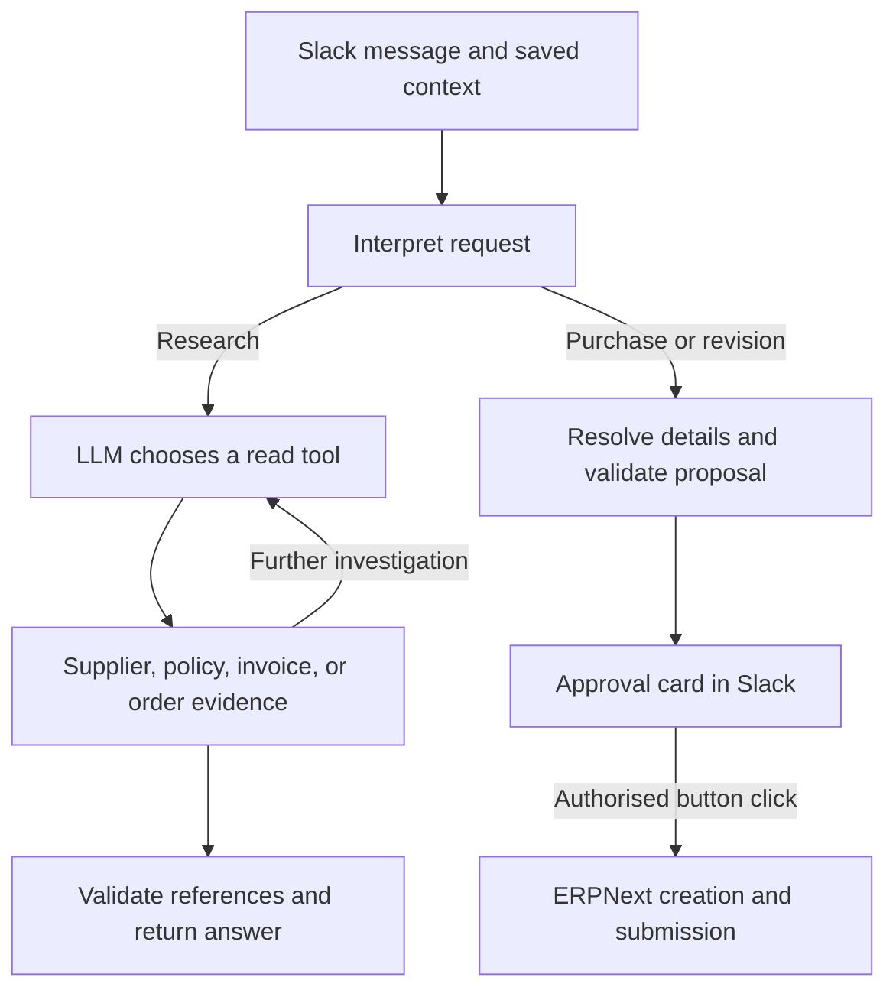

# Inherited application: Agentic Procurement Automation

This describes the original application retained as a reusable foundation.
It does not describe an implemented GraphRAG product. Paths below were originally
relative to the repository root.

A procurement copilot that connects **Slack, an LLM, and ERPNext**. Buyers can compare
suppliers, investigate invoice discrepancies, ask about purchasing policy, and prepare
purchase orders through conversation. ERP changes require an authorised user's button click.

The project is built for a single-company demo, with persistent conversation state,
evidence-backed recommendations, and an auditable approval workflow.

## Capabilities

- **Supplier recommendations:** compare recorded suppliers by historical price and delivery
  performance, request ranked options, exclude suppliers, or delegate a choice to the model.
- **Conversational purchasing:** specify a supplier directly, choose a shortlist option, and
  revise quantities or delivery dates. Missing details trigger clarification.
- **Policy questions:** retrieve relevant purchasing-policy sections and answer with citations.
- **Invoice investigation:** calculate discrepancies between invoices and purchasing records,
  then combine invoice, order, and policy evidence in one investigation.
- **Controlled ERP actions:** validate proposals, invalidate old approvals after revisions,
  and record approval and execution events in the application database.

Example requests:

> Which suppliers can provide ITEM-A? Compare price and delivery history.
>
> Buy 20 units of ITEM-A from the cheapest supplier, needed next Friday.
>
> Make that 30 units.
>
> Check this invoice against its purchase order and our invoice-match policy.

Use actual ERP item codes, supplier names, and invoice identifiers. `ITEM-A` is a synthetic
test-fixture item; the Mizan demo dataset includes codes such as `S-66100`.

## Tech stack

| Technology | Role |
| --- | --- |
| Python 3.11+ | Application, procurement calculations, validation, and execution logic |
| LangGraph | Explicit workflow graph and bounded, iterative research tool loop |
| LangChain / langchain-openai | Chat-model integration, tool schemas, and structured outputs |
| OpenAI | Request interpretation, supplier ranking, and evidence-based explanations; default model: `gpt-4.1-mini` |
| Slack Bolt / Slack SDK | Socket Mode listener, threaded conversations, commands, and approval buttons |
| ERPNext / Frappe REST API | System of record for suppliers, items, purchase orders, receipts, and invoices |
| PostgreSQL / SQLAlchemy / Psycopg | Conversation state, proposals, payload fingerprints, and audit events |
| Pydantic / pydantic-settings | Typed requests, proposal validation, and environment configuration |
| FastEmbed / BAAI bge-small-en-v1.5 | Local policy embeddings and in-process similarity retrieval |
| HTTPX / Tenacity | ERP API requests, timeouts, and retries for eligible read-client failures |
| Docker Compose | Local ERPNext stack and application PostgreSQL |
| uv / pytest / respx / Ruff / mypy / GitHub Actions | Dependency management, tests, HTTP mocks, linting, type checks, and CI |

ERPNext runs with MariaDB and Redis in its own Docker stack. The application uses a separate
PostgreSQL database. Its container image includes pgvector, while current policy retrieval
uses an in-process vector cache rather than a PostgreSQL vector index.

## Architecture



The model interprets requests and makes supplier recommendations from retrieved evidence.
Python checks identifiers, recorded prices, quantities, dates, and proposal integrity.
The research agent can call `lookup_sellers`, `compare_suppliers`, `search_policy`,
`check_invoices`, and `get_purchase_order`, choosing another tool after reading a result.
Research is limited to six tool-selection rounds and ten tool executions per message.

The model has no ERP write tool. Approval handlers reload the stored proposal and enforce
the approver allowlist. Orders within `ORDER_SUBMIT_LIMIT` (default 5,000, based on line total)
are created and submitted after approval. Larger orders are saved as drafts until a different
authorised approver submits them. The Slack card states the action its button will perform.

Conversation state and proposal revisions survive restarts through PostgreSQL. Intermediate
LangGraph messages last for one invocation; graph checkpointing is not enabled.

## Local setup

Prerequisites: Python 3.11+, uv, Docker Compose, an OpenAI API key, and a Slack app configured
for Socket Mode, message events, the `/propose` command, and interactive buttons.

1. Install dependencies with `make install` and copy `.env.example` to `.env`.
2. Configure the OpenAI and Slack credentials, `SLACK_CHANNEL_ID`, and
   `SLACK_APPROVER_USER_IDS`. Set `APP_TIMEZONE` and `ORDER_SUBMIT_LIMIT` as needed.
3. Start ERPNext with `make up-erpnext` and `make wait-erpnext`. Complete company setup in
   the ERPNext UI and configure ERP credentials in `.env`.
4. For the supplied demo data, follow the [ERPNext discovery notes](docs/erpnext-discovery.md)
   and run `make seed` after company setup.
5. Start the application database and listener:

```sh
make up-app
make init-db
make slack
```

ERPNext is available at `http://localhost:8080`; application PostgreSQL is exposed on port
`5433`. See [the local ERPNext stack](docker/erpnext/README.md) for details. Docker defaults
are intended for local development.

Start a supplier comparison in the configured Slack channel, then continue in the same thread
to prepare and revise a purchase. Normal messages use conversations scoped to thread and user;
repeated `/propose` commands share a conversation per channel and user.

## Testing

```sh
uv run pytest -p no:capture
uv run mypy src
uv run ruff check src tests scripts/slack_listen.py scripts/eval_demo.py
uv run python scripts/eval_demo.py --live
```

The test suite covers purchase revisions, approval boundaries, supplier validation, policy
citations, and result-dependent graph investigations. CI runs tests, type checks, and scoped
linting. `-p no:capture` works around a local Conda/readline issue observed on macOS.

The live rehearsal uses the configured LLM and API credits with synthetic records, a temporary
SQLite database, and a recording ERP writer. It does not connect to Slack or ERPNext.
The first policy lookup may download the local embedding model.

## Scope and data

Historical prices are estimates rather than current quotations. Delivery metrics describe
recorded receipt history and do not confirm stock availability or a future delivery commitment.
Source-reference validation establishes provenance, not the correctness of every model inference.

This demo supports exact item codes and one purchase item at a time. General database analytics,
stock planning, currency conversion, purchase-unit negotiation, and tax calculations are outside
its current scope. Confirm commercial terms before approving an order.

The sample procurement records come from findi360's synthetic Mizan dataset, licensed under
CC BY 4.0. See [dataset documentation](data/mizan/README.md) and
[import provenance and transformations](data/mizan/PROVENANCE.txt).
